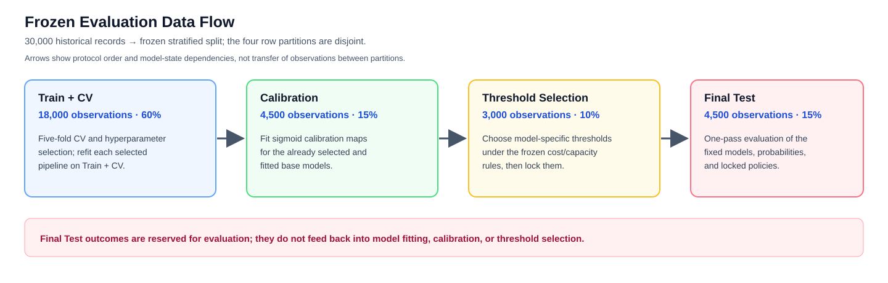

# DS-A4: Model Comparison and Calibration Lab

This project studies next-month credit-card default risk in the historical 2005 Taiwan cohort from the UCI Default of Credit Card Clients dataset (ID 350; DOI [10.24432/C55S3H](https://doi.org/10.24432/C55S3H)). The Phase 2 comparison evaluates Logistic Regression, Random Forest, and HistGradientBoosting on frozen paired folds, then examines independent sigmoid calibration and hypothetical cost/capacity rules. The end-of-September prediction cutoff is an assumption because intramonth feature-availability timestamps are unavailable. The study is an offline prediction and review-policy simulation; it does not estimate intervention effects or justify operational lending use.

## Status

Phase 1 acquisition and audit are complete. Evaluation Protocol v1.0 was frozen before model fitting. The three-model CV searches, refits, calibration, threshold decisions, Final Test metrics, paired bootstrap, slice analysis, and figures are present under `results/`. Phase 3A-1 independently verified the saved numerical evidence; Phase 3A-1b corrected and reverified a slice-narrative discrepancy. The student manually checked the single Random Forest true-positive observation and has reviewed and accepted the revised scientific narrative and conditional conclusions. This qualitative review does not claim manual recalculation of all results or verification of every prediction. The student has reviewed and approved the Phase 3B candidate PDF, SPAIQ results summary, and submission manifest. The student will personally handle Google Drive and SPAIQ actions. The original data archive is intentionally not tracked by Git.

For a ranking-focused offline follow-up, HGB is the leading candidate on observed AP/AUC (0.5798/0.7882); the saved paired intervals compare it with LR, not directly with RF. Under the frozen hypothetical 1:5 cost and 10% selection-set policy, RF has the lowest observed test loss (3,528), 13 units below HGB, with no uncertainty interval reported for that difference. In `PAY_0 = 0`, LR/RF/HGB selected 0/1/0 true positives; the distinct all-six-PAY-states-non-positive slice had 0/0/0. These results are from a same-cohort 2005 evaluation, not a deployment recommendation. See [Phase 2 results](docs/phase2_results.md) for the evidence and limitations.



## Layout

- `DS_A4_TASK_SPEC.md`: original assignment and Phase 1 specification, preserved.
- `data/raw/`: original UCI ZIP, excluded from Git; provenance and SHA-256 are recorded in the audit evidence.
- `scripts/audit_dataset.py`: Phase 1 source-data audit and provisional split generator.
- `scripts/experiment.py`: frozen CV, refit, calibration, threshold, test, and bootstrap pipeline.
- `scripts/finalize_reports.py`: validates completed experiment artifacts and derives slices/figures without refitting models.
- `docs/evaluation_protocol_v1.0.md`: frozen Phase 2 evaluation protocol.
- `docs/frozen_data_flow_v1.0.svg`: canonical diagram of disjoint frozen partitions and analysis sequence.
- `docs/dataset_audit.md`, `docs/phase2_results.md`, `docs/ai_use_log.md`: source audit, experiment findings, and assistance/verification record.
- `submission/`: student-approved Phase 3B candidate PDF, SPAIQ results summary, and submission/readiness manifest; external Drive and SPAIQ actions remain student-managed.
- `notebooks/DS_A4_model_comparison_calibration.ipynb`: English research notebook. By default it validates and presents existing results without retraining; set `RUN_FULL_EXPERIMENT = True` in its first code cell to repeat all 180 frozen CV fits.
- `results/audit/`: Phase 1 machine-readable evidence and frozen split indices.
- `results/cv/`, `results/models/`, `results/predictions/`, `results/statistics/`, `results/calibration/`, `results/slices/`, `results/diagnostics/`, `results/decisions/`, `results/figures/`: Phase 2 configurations, fitted artifacts, aligned outputs, statistics, tables, and figures.

## Reproducibility in `nussem1`

```sh
source "$(conda info --base)/etc/profile.d/conda.sh"
conda create -n nussem1 python=3.10 pip
conda activate nussem1
python -m pip install -r requirements.txt

# Acquire the excluded source archive; follow data/raw/README.md and verify its SHA-256.
curl --fail --location --output data/raw/uci_default_credit_card_350.zip \
  'https://archive.ics.uci.edu/static/public/350/default%2Bof%2Bcredit%2Bcard%2Bclients.zip'
shasum -a 256 data/raw/uci_default_credit_card_350.zip
unzip -t data/raw/uci_default_credit_card_350.zip

# Full frozen model run (180 CV fits; one worker; runtime depends on hardware).
MPLCONFIGDIR=/tmp/ds_a4_mpl python -m scripts.experiment

# Validate finalized reports/figures from completed model outputs without refitting.
MPLCONFIGDIR=/tmp/ds_a4_mpl python -m scripts.finalize_reports

# Independently verify the saved Phase 2 evidence without fitting models.
python scripts/verify_phase2_independently.py

# Targeted automated checks.
MPLCONFIGDIR=/tmp/ds_a4_mpl python -m pytest -q \
  tests/test_independent_verification.py tests/test_experiment.py
```

`scripts/audit_dataset.py` is a Phase 1 audit and provisional split generator,
not a step in reproducing the frozen Phase 2 experiment. Do not rerun it to
replace `results/audit/proposed_splits.json`.

To execute the notebook in saved-results mode without changing the reviewed
working copy, first make an isolated copy of the project, then run:

```sh
cp -R . /tmp/ds-a4-saved-results
cd /tmp/ds-a4-saved-results
MPLCONFIGDIR=/tmp/ds_a4_mpl IPYTHONDIR=/tmp/ds_a4_ipython jupyter nbconvert \
  --to notebook --execute --ExecutePreprocessor.enabled=True \
  --ExecutePreprocessor.timeout=-1 --inplace \
  notebooks/DS_A4_model_comparison_calibration.ipynb
```

The default `RUN_FULL_EXPERIMENT = False` validates and presents saved results;
the notebook finalizer may refresh derived reports and figures in that copy.
The full `scripts.experiment` command performs the 180-fit frozen search and
rewrites experiment outputs. Do not use it for saved-results inspection. The
split/fold seed is 42 and the paired-bootstrap seed is 2026. `requirements.txt`
pins the tested Python dependencies, including the notebook kernel and
execution tools. The final PDF was rendered separately with nbconvert WebPDF;
Chromium/Playwright are PDF-rendering tools and are not experiment dependencies.

The original source archive SHA-256 is `56c885f84457f6680f8438f02bfcdac9579323d8a94465ee5f26e32baa727602`. The protocol freeze and split hashes are recorded in `results/protocol_v1.0_freeze.json`. Tested dependencies are pinned in `requirements.txt`; the measured environment is recorded in `results/phase2_execution_report.json`.

## Dataset and License

This project uses the **Default of Credit Card Clients** dataset from the UCI Machine Learning Repository.

**Dataset citation:**

Yeh, I. (2009). *Default of Credit Card Clients* [Dataset]. UCI Machine Learning Repository. [https://doi.org/10.24432/C55S3H](https://doi.org/10.24432/C55S3H)

- **Source:** [UCI dataset page](https://archive.ics.uci.edu/dataset/350/default+of+credit+card+clients)
- **License:** Creative Commons Attribution 4.0 International (CC BY 4.0)
- **License URL:** [https://creativecommons.org/licenses/by/4.0/](https://creativecommons.org/licenses/by/4.0/)
- **Dataset ID:** 350

The original UCI archive is preserved unchanged in the local `data/raw/uci_default_credit_card_350.zip` file. It is intentionally excluded from this Git repository and will not be uploaded. All preprocessing, feature selection, experimental splits, and model outputs are produced separately by this project; the original source data is not modified. The dataset is used for academic research and reproducible offline evaluation. The resulting models are not intended for operational credit or lending decisions.
