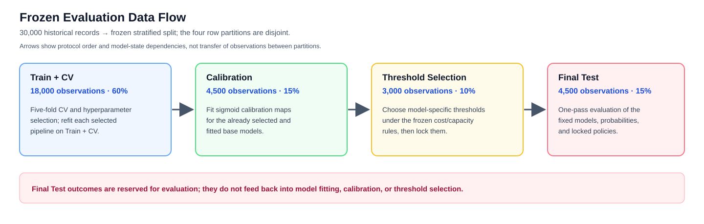

# Phase 2 Results — Frozen Protocol v1.0

**Status: core experiment and outputs generated; independent numerical verification and focused narrative correction are complete; the student has reviewed and accepted the revised narrative and conditional conclusions.** The student review was qualitative and does not imply manual recalculation of every numerical result or independent verification of every prediction. These are historical predictive results on the frozen sample. The student has also reviewed and approved the Phase 3B candidate PDF, summary, and manifest; course-platform submission remains pending. A repository commit was created earlier at the student's request; no tag was created.

## Research question and decision frame

The study asks whether Logistic Regression, Random Forest, and HistGradientBoosting differ in ranking next-month default risk and probability quality, and how their probabilities behave under a hypothetical capacity-constrained review policy. Average Precision (AP) summarizes the precision–recall relationship and is sensitive to positive-class prevalence. ROC-AUC summarizes ranking across thresholds and is theoretically invariant to prevalence when class-conditional score distributions remain unchanged. Neither metric selects an operating threshold. Applying the same numerical cutoff to differently calibrated scores can flag different records; a similar aggregate ranking score therefore need not yield the same selected cases or error cost. In this experiment each model's cutoff is separately selected and locked on Threshold Selection data.

The policy represents which records would be referred for hypothetical human review. It does not estimate what review would cause: the observed next-month label cannot reveal whether an intervention changes repayment.

The UCI dataset describes Taiwan credit-card clients and supplies a binary next-month outcome with historical predictors, making it suitable for supervised classification within this cohort ([UCI dataset description](https://archive.ics.uci.edu/dataset/350/default+of+credit+card+clients)). Its 22.12% full-dataset positive prevalence is retained rather than resampled; AP depends on prevalence, so the natural class share is important context for interpreting precision–recall results. Identical rows in the fixed splits and CV folds make model comparisons paired. The 19 primary predictors focus on credit-limit, repayment-status, bill, and payment history. Demographics were excluded to keep the primary comparison focused on account history and avoid using those attributes directly for prediction; they were retained for aggregate error auditing. Other predictors can still carry proxy information, so this feature choice is not a fairness guarantee.

UCI describes monthly repayment, bill, and payment records spanning April–September 2005, including September repayment status and statement amounts. The study assumes an end-of-September prediction cutoff, but neither the source data dictionary nor the workbook supplies intramonth feature-availability timestamps. Whether every September field would have been available at that exact cutoff—and therefore whether temporal look-ahead is absent—cannot be fully audited; look-ahead is a validity question, not a demonstrated occurrence. Repayment codes -2 and 0 were retained as distinct categorical states because the source does not document their meanings. Exact overlap on all 19 primary features occurs for 127 Final Test rows against Train+CV; this may weaken profile-level independence in a random row split, but does not establish repeated people. The split estimates performance within a 2005 Taiwan cohort and cannot establish future-year, post-economic/regulatory-change, contemporary-applicant, or cross-population performance.

## Freeze and reproducibility record

- Protocol: `docs/evaluation_protocol_v1.0.md`; SHA-256 `03ffa36a02fcdbbf8df8484ffdb84f58e063819899409812cb4e46a87abae418`.
- Split and fold artifact: `results/audit/proposed_splits.json`; SHA-256 `ded744149bd5afead62f3355d773eded3e9be1c8a53a5deabee38e104f42b1ed`.
- Original UCI ZIP SHA-256: `56c885f84457f6680f8438f02bfcdac9579323d8a94465ee5f26e32baa727602`.
- Environment: Conda `nussem1`; Python 3.10.18, pandas 2.3.1, NumPy 2.2.6, scikit-learn 1.7.1, xlrd 2.0.1, matplotlib 3.10.5, nbformat 5.10.4, nbclient 0.10.2, pytest 8.4.2; macOS 15.5 arm64.
- 180/180 CV configuration-fold fits succeeded (60 per model); no fit failures or convergence warnings. Recorded CV fit times total 1,155.3 seconds: Logistic Regression 9.0s, Random Forest 975.5s, HistGradientBoosting 170.9s. This is cumulative fit time, not equal CPU budget.
- Targeted automated verification: 10 tests passed, covering frozen hashes/splits, schema and leakage allowlist, shared preprocessing, ECE, calibration separation, paired-bootstrap resampling, locked threshold application, and prediction alignment.
- Final Test: 4,500 rows (995 positive, 3,505 negative). Bootstrap: 2,000 shared-index resamples, seed 2026; all 2,000 had both classes, so none were rejected for AP/ROC-AUC.
- The notebook was clean-kernel executed with `RUN_FULL_EXPERIMENT=False`: it revalidated the frozen artifacts, regenerated reports/figures, and displayed the saved outcomes without fitting another model. The complete CV/test artifacts were already present. A repeated full-search attempt was interrupted during Random Forest CV and did not replace the completed 180-row CV results or fitted artifacts. An earlier finalization stalled in report rendering; the point-by-point plotting loop was replaced by grouped curve plotting. These execution incidents are retained in `results/logs/phase2_execution_incidents.md`.

## Selected configurations

Selection used mean five-fold AP; exact ties would select the earliest grid entry. All models used the same frozen folds and Pipeline preprocessing.

| Model | Selected parameters | Mean CV AP | Fold SD |
| --- | --- | ---: | ---: |
| Logistic Regression | `C=3.0`, `class_weight=None` | 0.54250 | 0.01090 |
| Random Forest | `max_depth=8`, `min_samples_leaf=5`, `max_features=0.7` | 0.55652 | 0.01741 |
| HistGradientBoosting | `learning_rate=0.03`, `max_leaf_nodes=15`, `l2_regularization=0.0` | 0.56058 | 0.01367 |

All CV fold scores, configuration grids, fit seconds, warnings, selected parameters, and fitted model artifacts are stored in `results/cv/` and `results/models/`.

## Final Test discrimination and probability quality

| Model | AP raw / sigmoid | ROC-AUC raw / sigmoid | Brier raw / sigmoid | ECE raw / sigmoid |
| --- | ---: | ---: | ---: | ---: |
| Logistic Regression | 0.5574 / 0.5574 | 0.7694 / 0.7694 | 0.13528 / 0.13553 | 0.01370 / 0.01538 |
| Random Forest | 0.5750 / 0.5750 | 0.7820 / 0.7820 | 0.13274 / 0.13368 | 0.01315 / 0.01785 |
| HistGradientBoosting | 0.5798 / 0.5798 | 0.7882 / 0.7882 | 0.13200 / 0.13192 | 0.01113 / 0.01060 |

On these saved predictions, sigmoid calibration preserved AP and ROC-AUC for each model, consistent with the fitted monotonic mapping preserving within-model order, subject to numerical ties. Probability quality changed empirically: LR Brier/ECE rose by 0.00026/0.00168, RF by 0.00094/0.00469, while HGB fell slightly by 0.00008/0.00053. Calibration therefore helped HGB slightly and worsened both measures for LR and RF in this experiment.

Possible explanations include differences in the models' original score distributions and how well a single sigmoid mapping matches their calibration-error shapes. Logistic Regression's probabilistic form does not guarantee calibrated outputs, and averaging tree probabilities does not by itself establish a particular calibration pattern. These mechanisms were not tested here. The saved LR reliability bins show descriptive redistribution: bin 1 grew from 2,609 to 2,778 records, and its weighted absolute gap contribution increased from about 0.00319 to 0.00531; bin 4 grew from 86 to 103 records and its contribution rose from about 0.00113 to 0.00256. Other bins offset part of these increases. Bin membership alone does not explain why scores moved; this weighted decomposition accounts for the ECE change under the fixed bins, without identifying a causal mechanism. Brier and ten-bin ECE describe probability quality differently, and ECE depends on the specified bins.

### Calibrated model estimates and 95% percentile intervals

| Model | AP | ROC-AUC | Brier | ECE |
| --- | --- | --- | --- | --- |
| Logistic Regression | 0.5574 [0.5246, 0.5894] | 0.7694 [0.7521, 0.7869] | 0.13553 [0.12930, 0.14209] | 0.01538 [0.00992, 0.02773] |
| Random Forest | 0.5750 [0.5430, 0.6058] | 0.7820 [0.7646, 0.7987] | 0.13368 [0.12721, 0.14013] | 0.01785 [0.01249, 0.03180] |
| HistGradientBoosting | 0.5798 [0.5460, 0.6115] | 0.7882 [0.7712, 0.8047] | 0.13192 [0.12564, 0.13815] | 0.01060 [0.00913, 0.02474] |

### Paired differences versus Logistic Regression

Each entry is compared model minus Logistic Regression, using identical bootstrap rows. Negative differences favor the compared model for Brier/ECE; positive differences favor it for AP/ROC-AUC.

| Score type | Model | AP difference [95% CI] | ROC-AUC difference [95% CI] | Brier difference [95% CI] | ECE difference [95% CI] |
| --- | --- | --- | --- | --- | --- |
| Raw | Random Forest | +0.01759 [0.00271, 0.03165] | +0.01262 [0.00201, 0.02222] | -0.00254 [-0.00414, -0.00094] | -0.00055 [-0.00908, 0.01068] |
| Raw | HistGradientBoosting | +0.02243 [0.01078, 0.03441] | +0.01877 [0.00934, 0.02809] | -0.00328 [-0.00470, -0.00184] | -0.00257 [-0.00937, 0.01000] |
| Sigmoid | Random Forest | +0.01759 [0.00271, 0.03165] | +0.01262 [0.00201, 0.02222] | -0.00186 [-0.00338, -0.00035] | +0.00247 [-0.00478, 0.01162] |
| Sigmoid | HistGradientBoosting | +0.02243 [0.01078, 0.03441] | +0.01877 [0.00934, 0.02809] | -0.00362 [-0.00508, -0.00219] | -0.00478 [-0.01150, 0.00768] |

The saved table contains 24 model × score-type × metric point estimates and 24 corresponding model-specific 95% percentile intervals. The protocol reports paired differences against LR: 16 non-baseline contrasts (RF vs LR and HGB vs LR, for two score types and four metrics); the eight LR-vs-itself entries are zero reference rows. These are marginal intervals, not 24 independent hypothesis tests, and no family-wise error adjustment was applied. The positive AP/AUC intervals for RF and HGB versus LR support those paired differences within this fixed-model resampling analysis; they do not establish an HGB–RF difference. HGB's observed AP exceeds RF's by about 0.00484, with no direct paired interval reported. The shared-index bootstrap conditions on frozen selected hyperparameters, fitted models, calibrators, and fixed predictions. It excludes their refitting/selection variability and temporal or population change. With 2,000 draws, interval endpoints have finite Monte Carlo precision; percentile intervals for a binned, non-smooth statistic such as ECE also warrant care. These limits do not invalidate the prespecified bootstrap. ECE paired intervals include zero for both non-baseline comparisons.

## Threshold, cost, and capacity findings

Primary scenario: hypothetical FP cost 1, FN cost 5, maximum 10% flagged on the 3,000-row Threshold Selection subset. Thresholds were locked there and applied unchanged to test.

| Model | Locked threshold | Selection flagged | Selection loss | Test flagged | Test TP / FP / FN | Test loss |
| --- | ---: | ---: | ---: | ---: | --- | ---: |
| Logistic Regression | 0.567186 | 298 / 3,000 (9.93%) | 2,424 | 416 / 4,500 (9.24%) | 298 / 118 / 697 | 3,603 |
| Random Forest | 0.571389 | 300 / 3,000 (10.00%) | 2,408 | 425 / 4,500 (9.44%) | 312 / 113 / 683 | 3,528 |
| HistGradientBoosting | 0.591527 | 300 / 3,000 (10.00%) | 2,414 | 420 / 4,500 (9.33%) | 309 / 111 / 686 | 3,541 |

This policy minimizes `FP + 5 × FN` on the separate Threshold Selection subset subject to at most 10% flagged there; each model's calibrated-probability threshold is then locked and applied unchanged to Final Test. RF's test loss is 3,528, 13 hypothetical units below HGB's 3,541, although HGB has the highest observed AP/AUC. No direct paired uncertainty interval for this fixed-policy loss difference was reported, so the 13-unit gap is a point comparison. Across the prespecified 3 × 3 sensitivity grid, RF has the lowest reported test loss in eight scenarios and HGB in one; results remain conditional on the assumed cost ratios and capacities. Test flag rates are observations under locked thresholds, not guarantees for future batches. Top-K instead enforces a fixed per-batch count and may select different records; see `top_k_test_results.csv`.

At test-set Top-K capacity 10% (K=450), TP/FP/FN and hypothetical 1:5 loss were 315/135/680 and 3,535 (Logistic Regression), 327/123/668 and 3,463 (Random Forest), and 326/124/669 and 3,469 (HistGradientBoosting). Top-K is a hard-capacity ranking comparison and is not the locked probability-threshold policy.

## Failure slices and counterexamples

- **All six PAY states non-positive:** 3,042 test records, including 357 observed positives. Under each model's primary locked threshold, none of those 357 positives were flagged (TP = 0 for Logistic Regression, Random Forest, and HistGradientBoosting). This is a limitation of the chosen review rule, not a claim that the models cannot rank risks within the subgroup.
- **PAY_0 = 0:** 2,229 records, 285 positives. Under the frozen primary thresholds, Logistic Regression and HistGradientBoosting selected no true positives, while Random Forest selected one (TP = 0/1/0 for Logistic Regression / Random Forest / HistGradientBoosting). The RF observation has positive values in other PAY fields, so it is not part of the all-six-PAY-states-non-positive subgroup. This indicates very limited review coverage under the assumed policy, rather than universal inability to discriminate risk within this subgroup. Slice ranking AP was 0.2431 (Logistic Regression), 0.2428 (Random Forest), and 0.2491 (HistGradientBoosting).

These two PAY-based subgroups overlap but are not equivalent: the all-six-states-non-positive group can include records with `PAY_0 = 0` when the other five PAY states are also non-positive; the `PAY_0 = 0` group also contains records with positive values in other PAY states. In the first subgroup, all models have zero threshold-selected TPs, although AP ranges from 0.1678 to 0.2035 versus a subgroup positive prevalence of about 11.7%. That contrast illustrates that threshold misses do not by themselves establish an absence of ranking information. The `PAY_0 = 0` AP values are 0.2428–0.2491 with 285/2,229 positives; these are descriptive slice metrics without subgroup-specific intervals. The zero/one RF TP correction is documented in the independent-verification audit trail. The counts and outcomes above are reported separately.

- **Exact primary-profile overlap with Train+CV:** 127 Final Test records (2.82%) exactly matched at least one Train+CV row on the 19 primary features; 57 were positive. For this small overlap group, AP/AUC were 0.5098/0.4821 (Logistic Regression), 0.5794/0.5792 (Random Forest), and 0.5763/0.5916 (HistGradientBoosting). On 4,373 non-overlap records, AUCs were 0.7737, 0.7807, and 0.7874. This is a genuine profile-level weakness/instability signal, but identical profiles do not prove repeated individuals and the 127-row subgroup is limited.
- In the signed bill-to-limit upper tertile (1,461 test rows), Random Forest AP (0.5913) was slightly below Logistic Regression AP (0.5944), while HistGradientBoosting was 0.6003. Subgroup differences are descriptive and no slice-specific tuning was done.

The signed September `BILL_AMT1 / LIMIT_BAL` proxy retained negative values; train-derived tertile cutpoints were 0.062509 and 0.6666. Credit-limit tertile cutpoints were 80,000 and 200,000. Full behavior slices and supplementary demographic aggregate error counts are saved in `results/slices/`. Sparse categories (for example, EDUCATION 4 n=22, EDUCATION 6 n=9, MARRIAGE 0 n=7, and PAY_0 tail groups) are not stable bases for subgroup conclusions. No customer-level narratives or ID-based interpretations were produced.

## Figures and machine-readable evidence

- `results/figures/pr_curves.png`: Final Test PR curves for calibrated scores.
- `results/figures/roc_curves.png`: Final Test ROC curves for calibrated scores.
- `results/figures/reliability_diagrams.png`: raw and calibrated reliability bins with counts in the accompanying CSV.
- `results/figures/calibration_comparison.png`: Brier and ECE raw/calibrated comparisons.
- `results/figures/cost_capacity_sensitivity.png`: locked test loss across planned capacities and cost ratios.
- `results/figures/slice_average_precision.png`: calibrated AP across prespecified behavior slices.
- `results/figures/duplicate_profile_overlap.png`: profile-overlap versus non-overlap test comparison.

Paired predictions are in `results/predictions/final_test_predictions.csv`; bootstrap indices and replicate metrics are in `results/statistics/`; thresholds, costs, and Top-K records are in `results/decisions/`. `results/phase2_execution_report.json` verifies the frozen hashes and output counts.

## Limitations

This is a 2005 Taiwan cohort assessed with a random row split. It estimates performance under a same-cohort setting; it does not test future years, economic or regulatory change, contemporary applicants, or other populations. UCI documents monthly measures spanning April–September 2005, but provides no intramonth feature-availability timestamps. End-of-September is the assumed prediction cutoff, so whether every September field was operationally available at that point—and whether look-ahead is absent—cannot be fully audited. The source leaves some observed PAY code meanings undocumented; those states remain separate categories. Exact 19-feature profiles cross partitions, which weakens profile-level separation without proving repeated identities. The intervals condition on fixed fitted models and do not capture selection/refitting or temporal shift. The decision costs and review capacity are assumptions; no intervention outcomes were observed.

## Conditional conclusion

For a ranking-focused next step, HistGradientBoosting is the preferred candidate for further offline evaluation: it has the highest observed AP (0.5798) and ROC-AUC (0.7882), and its paired AP/AUC differences versus Logistic Regression have 95% intervals above zero. The available intervals do not directly compare HGB with Random Forest. For the frozen 1:5 cost ratio and 10% selection-set capacity, Random Forest has the lowest observed test loss (3,528), just 13 units below HGB; no paired uncertainty interval for this fixed-policy loss difference was reported. Logistic Regression remains the interpretable reference. None is ready for an operational recommendation. A conclusion could change with temporally representative and external evaluation, verified point-in-time feature availability, a prespecified direct HGB–RF comparison, and evidence of real intervention outcomes and costs.
